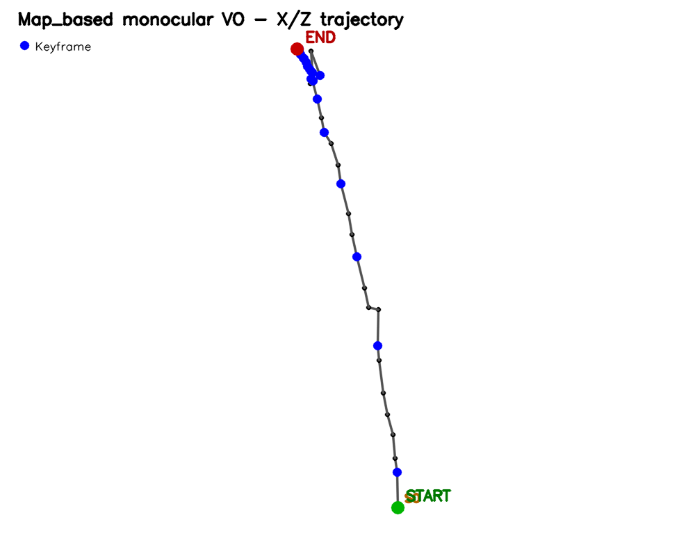
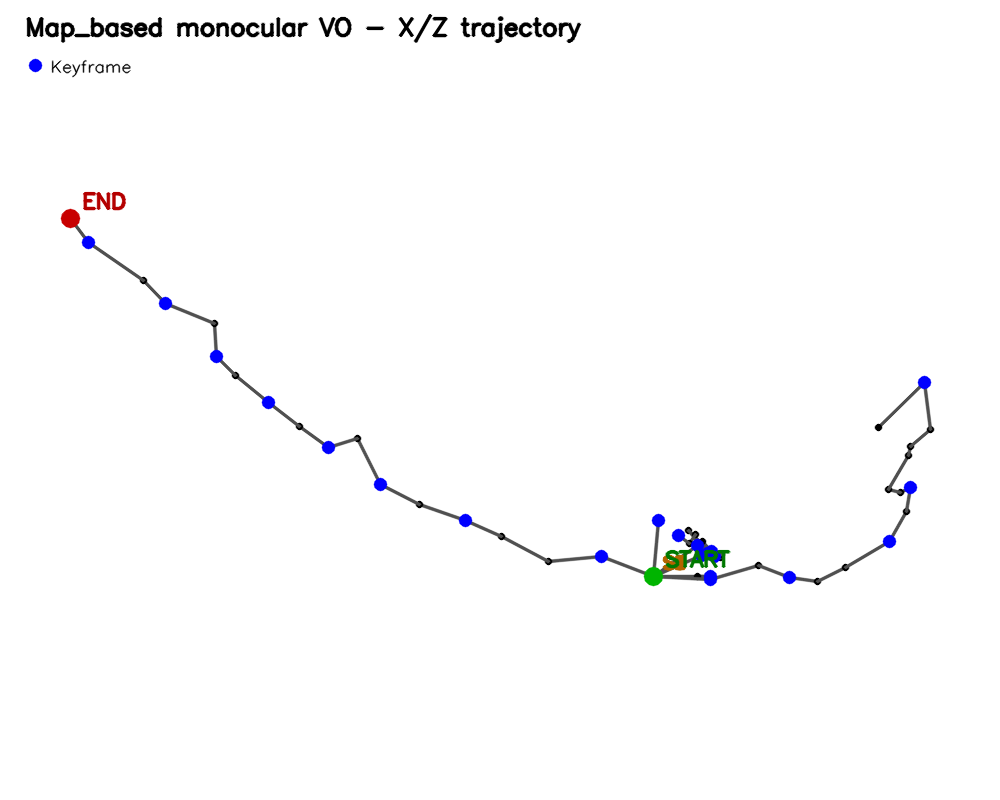
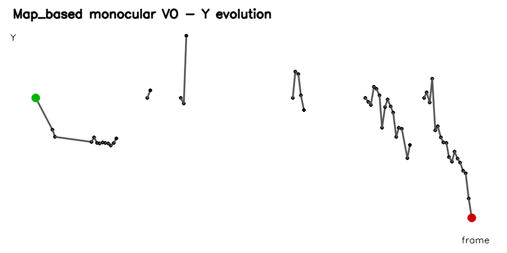
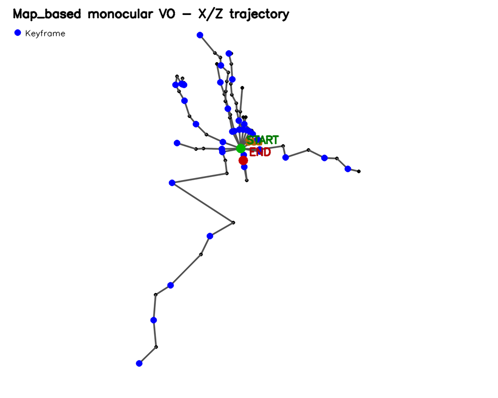
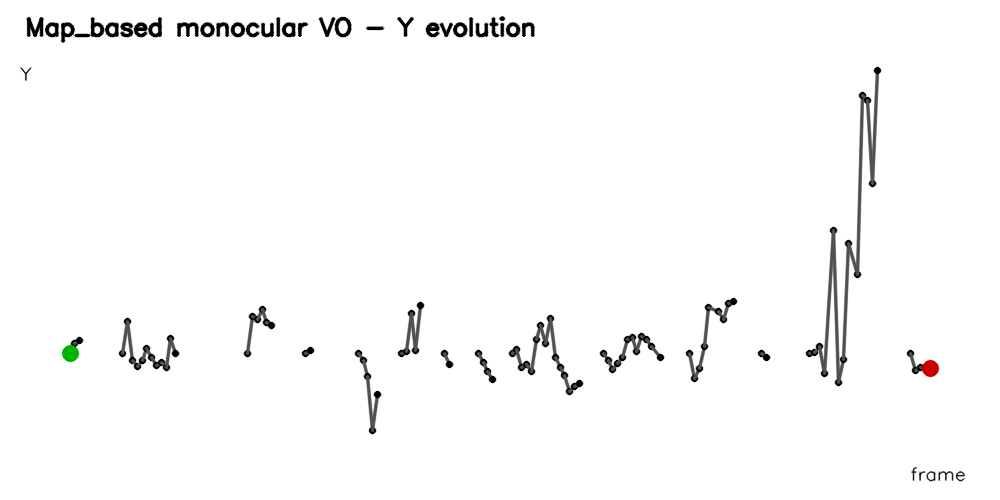

# Monocular Visual Odometry and Mapping

**C++20 • OpenCV • Eigen • Ceres Solver • Computer Vision • Visual Odometry • 3D Reconstruction**

[Français](#français) | [English](#english)

---

# Français

## Présentation

Ce projet implémente un pipeline complet d’**odométrie visuelle monoculaire basée sur une carte 3D**, développé en C++.

À partir d’une vidéo issue d’une seule caméra, le système estime le mouvement de la caméra, construit progressivement une carte de points 3D, sélectionne dynamiquement des images-clés, optimise localement la structure et les poses par **Bundle Adjustment**, puis détecte et récupère automatiquement certaines pertes de tracking.

Le projet a été développé comme projet personnel de vision par ordinateur afin d’explorer les principales briques utilisées dans les systèmes de **Visual Odometry** et de **SLAM visuel**.

> Le système reste une odométrie visuelle monoculaire avec cartographie locale.
>
> Il n’implémente pas de fermeture de boucle globale ni de fusion Sim(3) entre les segments reconstruits après une perte de tracking.

---

## Fonctionnalités principales

- Détection et description de points d’intérêt avec **ORB**
- Matching de descripteurs avec test de ratio de Lowe
- Estimation de la matrice essentielle avec **RANSAC**
- Estimation de pose relative avec `recoverPose`
- Triangulation de points 3D
- Validation géométrique par :
  - cheirality ;
  - parallaxe minimale ;
  - erreur de reprojection
- Construction et extension dynamique d’une carte 3D
- Association de points 3D avec les observations 2D
- Estimation de pose par **PnP + RANSAC**
- Sélection adaptative de keyframes
- Gestion de la qualité et suppression de points 3D obsolètes
- Bundle Adjustment local avec **Ceres Solver**
- Protections contre les corrections BA instables
- Détection automatique des pertes de tracking
- Recherche d’une nouvelle géométrie locale deux-vues
- Re-bootstrap automatique après perte prolongée
- Gestion de plusieurs segments monoculaires indépendants
- Validation de la stabilité d’un re-bootstrap par plusieurs poses PnP
- Export des trajectoires au format CSV
- Visualisation X/Z et évolution verticale Y
- Comparaison de trajectoires par alignement de similarité

---

## Pipeline

```text
Vidéo monoculaire
        |
        v
Détection ORB
        |
        v
Matching des descripteurs
+ Lowe ratio test
        |
        v
Matrice essentielle
+ RANSAC
        |
        v
Pose relative R, t
        |
        v
Triangulation
        |
        v
Carte 3D initiale
        |
        v
Matching carte 3D / image
        |
        v
PnP + RANSAC
        |
        v
Estimation de pose
        |
        +------------------------+
        |                        |
        v                        v
Keyframes                Suivi de la qualité
        |                        |
        v                        v
Extension de carte         Culling
        |
        v
Bundle Adjustment local
        |
        v
Détection de perte de tracking
        |
        v
Recovery deux-vues
        |
        v
Validation 3D
        |
        v
Re-bootstrap d'un
nouveau segment local
```

---

## Dépendances

Le projet utilise :

- **C++20**
- **OpenCV**
- **Eigen**
- **Ceres Solver**
- **CMake**
- **vcpkg**

Le développement et les tests ont principalement été réalisés sous Windows avec MSVC et Visual Studio.

---

## Compilation

### 1. Cloner le dépôt

```bash
git clone https://github.com/I-am-Axel-Helios/monocular-visual-odometry-and-mapping.git
cd monocular-visual-odometry-and-mapping
```

### 2. Installer les dépendances avec vcpkg

Le projet fournit un fichier `vcpkg.json`.

### 3. Configurer CMake

Sous PowerShell :

```powershell
cmake -S . -B build `
    -DCMAKE_TOOLCHAIN_FILE="$env:VCPKG_ROOT\scripts\buildsystems\vcpkg.cmake" `
    -DVCPKG_TARGET_TRIPLET=x64-windows
```

### 4. Compiler

```powershell
cmake --build build --config Debug
```

---

## Calibration de la caméra

Le projet contient un outil de calibration basé sur OpenCV :

```text
tools/camera_calibration.cpp
```

Les paramètres utilisés pour les expérimentations principales sont stockés dans :

```text
config/camera_calibration_1920x1080.yaml
```

Une calibration cohérente avec la résolution de la vidéo est nécessaire pour obtenir une reconstruction géométrique correcte.

---

## Utilisation

### Odométrie visuelle basée sur carte

```powershell
.\build\Debug\map_visual_odometry.exe `
    <video_path> `
    <camera_calibration.yaml> `
    <trajectory_output.csv> `
    <sampling_interval_seconds>
```

Exemple :

```powershell
.\build\Debug\map_visual_odometry.exe `
    .\data\vo_sequences\main\sequence_main.mp4 `
    .\config\camera_calibration_1920x1080.yaml `
    .\results\vo\main\trajectory_map_based.csv `
    0.5
```

---

## Visualisation

```powershell
.\build\Debug\visualize_trajectory.exe `
    <trajectory.csv> `
    <output.png>
```

Le visualiseur produit :

- une trajectoire X/Z ;
- une visualisation de l’évolution verticale Y ;
- l’emplacement des keyframes ;
- les limites entre les différents segments de trajectoire.

Les segments issus de re-bootstrap différents ne sont volontairement **pas reliés graphiquement**.

---

## Format de trajectoire

Les trajectoires exportées utilisent les colonnes :

```text
frame_index,
time_seconds,
x,
y,
z,
good_matches,
pose_inliers,
is_keyframe,
segment_id
```

`segment_id` permet de distinguer les repères locaux créés après une perte complète de tracking.

---

## Résultats expérimentaux

Trois séquences ont été utilisées pour tester différents comportements du système.

| Séquence | Frames sélectionnées | Poses réussies | Pertes de tracking | Re-bootstrap | Stables | Segments |
|---|---:|---:|---:|---:|---:|---:|
| `main` | 63 | 61 | 0 | 0 | 0 | 1 |
| `varied_motion` | 163 | 51 | 7 | 5 | 3 | 6 |
| `loop` | 180 | 81 | 13 | 13 | 10 | 14 |

### Séquence `main`

La séquence principale sert de test de non-régression.

Le système conserve le tracking sur toute la séquence :

```text
Successful pose steps: 61
Tracking loss events: 0
Recovery re-bootstrap events: 0
Trajectory segments: 1
Final tracking state: TRACKING
```



---

### Séquence `varied_motion`

Cette séquence contient des mouvements plus difficiles et provoque plusieurs pertes du suivi de la carte.

Le système est capable de détecter ces pertes et de créer de nouveaux segments monoculaires lorsque la récupération de l’ancienne carte n’est plus possible.

```text
Successful pose steps: 51
Tracking loss events: 7
Recovery re-bootstrap events: 5
Stable recovery re-bootstrap events: 3
Unstable recovery re-bootstrap events: 2
Trajectory segments: 6
```





---

### Séquence `loop`

Cette séquence constitue un stress test plus long.

```text
Selected frames: 180
Successful pose steps: 81

Tracking loss events: 13
Recovery re-bootstrap events: 13

Stable recovery re-bootstrap events: 10
Unstable recovery re-bootstrap events: 3

Trajectory segments: 14
Final tracking state: TRACKING
```

Le système récupère donc plusieurs fois après des pertes de tracking importantes.





---

## Bundle Adjustment local

Les keyframes récentes sont optimisées avec **Ceres Solver**.

Le Bundle Adjustment optimise conjointement :

- les poses des caméras ;
- les positions des points 3D ;
- l’erreur de reprojection.

Les deux poses les plus anciennes de la fenêtre locale sont maintenues fixes afin de contraindre le problème.

Plusieurs garde-fous empêchent une optimisation instable de dégrader la carte :

- vérification des valeurs finies ;
- contrôle des déplacements relatifs des points ;
- limitation des corrections de pose ;
- rejet du write-back lorsque la correction proposée est trop importante.

---

## Gestion des pertes de tracking

Lorsque plusieurs poses PnP successives échouent, le système passe dans l’état :

```text
TRACKING LOST
```

Une référence glissante est alors utilisée pour rechercher une nouvelle géométrie deux-vues.

Le candidat doit vérifier plusieurs critères :

```text
matches suffisants
        +
inliers recoverPose
        +
ratio d'inliers
        +
cheirality
        +
parallaxe
        +
erreur de reprojection
```

Un seul candidat n’est pas suffisant.

Deux reconstructions 3D valides suffisamment proches temporellement sont nécessaires pour confirmer un re-bootstrap.

Après création de la nouvelle carte locale, le segment est considéré comme **stable** uniquement si plusieurs poses PnP consécutives réussissent.

---

## Gestion multi-segments

Après une perte complète du tracking, une caméra monoculaire ne permet pas de récupérer directement l’échelle métrique ni la transformation globale exacte entre l’ancienne carte et la nouvelle.

Chaque re-bootstrap crée donc volontairement un nouveau :

```text
segment_id
```

Les segments restent dans leurs propres repères locaux.

Le projet ne prétend donc pas fournir une trajectoire métrique globale continue après plusieurs re-bootstrap.

---

## Structure du projet

```text
monocular-visual-odometry-and-mapping/
|
|-- CMakeLists.txt
|-- vcpkg.json
|-- vcpkg-configuration.json
|-- README.md
|
|-- config/
|   |-- camera_calibration.yaml
|   |-- camera_calibration_1080x810.yaml
|   `-- camera_calibration_1920x1080.yaml
|
|-- src/
|   |-- main.cpp
|   |-- video_visual_odometry.cpp
|   `-- map_visual_odometry.cpp
|
|-- tools/
|   |-- camera_calibration.cpp
|   |-- extract_video_frames.cpp
|   |-- visualize_trajectory.cpp
|   `-- compare_trajectories.cpp
|
`-- docs/
    `-- assets/
```

Les dossiers suivants restent locaux et sont ignorés par Git :

```text
build/
data/
results/
vcpkg_installed/
```

---

## Limites actuelles

Le projet ne possède actuellement pas :

- de ground truth pour mesurer une erreur absolue de trajectoire ;
- de fermeture de boucle globale ;
- de reconnaissance de lieux ;
- de graphe de poses global ;
- de fusion Sim(3) entre les segments ;
- de reconstruction métrique absolue.

La translation obtenue par une caméra monoculaire possède une **échelle inconnue**.

Les distances affichées sont donc exprimées en **unités arbitraires**.

---

## Améliorations possibles

Plusieurs extensions seraient possibles :

- loop closure ;
- place recognition ;
- pose graph optimization ;
- fusion Sim(3) des segments ;
- utilisation d’un dataset avec ground truth, par exemple KITTI ou EuRoC ;
- évaluation ATE / RPE ;
- reconstruction 3D plus dense ;
- tracking temporel par optical flow ;
- intégration d’un front-end temps réel.

---

## Objectif du projet

Ce projet vise principalement à montrer la compréhension et l’implémentation pratique des briques fondamentales d’un système de vision géométrique :

```text
Feature extraction
Matching
Epipolar geometry
Pose estimation
Triangulation
3D mapping
PnP
Keyframes
Bundle Adjustment
Map management
Tracking recovery
```

---

# English

## Overview

This project implements a complete **map-based monocular visual odometry pipeline** in C++.

From a video captured with a single camera, the system estimates camera motion, progressively builds a sparse 3D map, dynamically selects keyframes, locally optimizes camera poses and landmarks using **Bundle Adjustment**, and detects and recovers from several tracking-loss situations.

The project was developed as a personal computer vision project to explore the main building blocks used in **Visual Odometry** and **visual SLAM** systems.

> The current implementation remains a monocular visual odometry system with local mapping.
>
> It does not implement global loop closure or Sim(3) fusion between independently re-bootstrapped segments.

---

## Main features

- **ORB** feature detection and description
- Descriptor matching with Lowe's ratio test
- Essential matrix estimation using **RANSAC**
- Relative pose estimation using `recoverPose`
- 3D point triangulation
- Geometric validation using:
  - cheirality;
  - minimum parallax;
  - reprojection error
- Incremental sparse 3D map construction
- 3D landmark to 2D observation association
- Camera localization using **PnP + RANSAC**
- Adaptive keyframe selection
- Map-point quality management and culling
- Local Bundle Adjustment using **Ceres Solver**
- Safety checks against unstable BA updates
- Automatic tracking-loss detection
- Rolling two-view recovery
- Automatic map re-bootstrap after persistent tracking loss
- Independent monocular trajectory segments
- Post-rebootstrap stability validation using consecutive PnP poses
- CSV trajectory export
- X/Z trajectory and Y-drift visualization
- Trajectory comparison using similarity alignment

---

## Pipeline

```text
Monocular video
       |
       v
ORB features
       |
       v
Descriptor matching
+ Lowe ratio test
       |
       v
Essential matrix
+ RANSAC
       |
       v
Relative pose R, t
       |
       v
Triangulation
       |
       v
Initial sparse 3D map
       |
       v
3D map / image matching
       |
       v
PnP + RANSAC
       |
       v
Camera pose estimation
       |
       +-------------------------+
       |                         |
       v                         v
Adaptive keyframes        Map-quality tracking
       |                         |
       v                         v
Map extension                Culling
       |
       v
Local Bundle Adjustment
       |
       v
Tracking-loss detection
       |
       v
Two-view recovery
       |
       v
3D validation
       |
       v
New local segment
re-bootstrap
```

---

## Dependencies

The project uses:

- **C++20**
- **OpenCV**
- **Eigen**
- **Ceres Solver**
- **CMake**
- **vcpkg**

Development and testing were mainly performed on Windows using MSVC and Visual Studio.

---

## Build

### 1. Clone the repository

```bash
git clone https://github.com/I-am-Axel-Helios/monocular-visual-odometry-and-mapping.git
cd monocular-visual-odometry-and-mapping
```

### 2. Install dependencies

Dependencies are declared through `vcpkg.json`.

### 3. Configure CMake

PowerShell example:

```powershell
cmake -S . -B build `
    -DCMAKE_TOOLCHAIN_FILE="$env:VCPKG_ROOT\scripts\buildsystems\vcpkg.cmake" `
    -DVCPKG_TARGET_TRIPLET=x64-windows
```

### 4. Build

```powershell
cmake --build build --config Debug
```

---

## Camera calibration

A camera calibration utility based on OpenCV is provided in:

```text
tools/camera_calibration.cpp
```

The main experiments used:

```text
config/camera_calibration_1920x1080.yaml
```

The calibration parameters must correspond to the input video resolution.

---

## Usage

### Map-based visual odometry

```powershell
.\build\Debug\map_visual_odometry.exe `
    <video_path> `
    <camera_calibration.yaml> `
    <trajectory_output.csv> `
    <sampling_interval_seconds>
```

Example:

```powershell
.\build\Debug\map_visual_odometry.exe `
    .\data\vo_sequences\main\sequence_main.mp4 `
    .\config\camera_calibration_1920x1080.yaml `
    .\results\vo\main\trajectory_map_based.csv `
    0.5
```

---

## Trajectory visualization

```powershell
.\build\Debug\visualize_trajectory.exe `
    <trajectory.csv> `
    <output.png>
```

The visualization utility displays:

- the X/Z trajectory;
- vertical Y evolution;
- selected keyframes;
- trajectory segment boundaries.

Independent segments are intentionally **not connected by artificial trajectory lines**.

---

## Trajectory format

The generated CSV file contains:

```text
frame_index,
time_seconds,
x,
y,
z,
good_matches,
pose_inliers,
is_keyframe,
segment_id
```

`segment_id` identifies independently reconstructed local coordinate systems.

---

## Experimental results

Three sequences were used to evaluate different operating conditions.

| Sequence | Selected frames | Successful poses | Tracking losses | Re-bootstraps | Stable | Segments |
|---|---:|---:|---:|---:|---:|---:|
| `main` | 63 | 61 | 0 | 0 | 0 | 1 |
| `varied_motion` | 163 | 51 | 7 | 5 | 3 | 6 |
| `loop` | 180 | 81 | 13 | 13 | 10 | 14 |

### `main`

The main sequence is used as a non-regression test.

```text
Successful pose steps: 61
Tracking loss events: 0
Recovery re-bootstrap events: 0
Trajectory segments: 1
Final tracking state: TRACKING
```


---

### `varied_motion`

This sequence contains stronger motion changes and causes several losses of map observability.

The recovery system detects these failures and creates new local monocular maps when the previous map can no longer be reliably tracked.

```text
Successful pose steps: 51
Tracking loss events: 7
Recovery re-bootstrap events: 5
Stable recovery re-bootstrap events: 3
Unstable recovery re-bootstrap events: 2
Trajectory segments: 6
```


---

### `loop`

The loop sequence is a longer and more difficult stress test.

```text
Selected frames: 180
Successful pose steps: 81

Tracking loss events: 13
Recovery re-bootstrap events: 13

Stable recovery re-bootstrap events: 10
Unstable recovery re-bootstrap events: 3

Trajectory segments: 14
Final tracking state: TRACKING
```


---

## Local Bundle Adjustment

Recent keyframes are jointly optimized using **Ceres Solver**.

The optimization refines:

- camera poses;
- 3D landmark positions;
- reprojection error.

The two oldest poses in the local optimization window are kept fixed to constrain the optimization.

Several safeguards prevent unstable optimizations from corrupting the map:

- finite-value checks;
- relative landmark displacement limits;
- camera-pose correction limits;
- rejected write-back when the proposed correction is too large.

---

## Tracking-loss recovery

After several consecutive PnP failures, the system enters:

```text
TRACKING LOST
```

A rolling image reference is then used to estimate new two-view geometry.

Recovery candidates must pass several tests:

```text
sufficient matches
       +
recoverPose inliers
       +
inlier ratio
       +
cheirality
       +
parallax
       +
reprojection error
```

A single valid reconstruction is not sufficient.

Two valid 3D recovery candidates must occur within a limited temporal window before a new map is installed.

After the re-bootstrap, the new segment is considered **stable** only after multiple consecutive successful PnP poses.

---

## Multi-segment trajectory

Following complete tracking loss, monocular vision cannot directly recover the absolute metric scale or exact global transform between the old map and the new reconstruction.

Each re-bootstrap therefore creates a new:

```text
segment_id
```

Each segment has its own local monocular coordinate system.

The project therefore does **not** claim a globally continuous metric trajectory after multiple re-bootstraps.

---

## Project structure

```text
monocular-visual-odometry-and-mapping/
|
|-- CMakeLists.txt
|-- vcpkg.json
|-- vcpkg-configuration.json
|-- README.md
|
|-- config/
|   |-- camera_calibration.yaml
|   |-- camera_calibration_1080x810.yaml
|   `-- camera_calibration_1920x1080.yaml
|
|-- src/
|   |-- main.cpp
|   |-- video_visual_odometry.cpp
|   `-- map_visual_odometry.cpp
|
|-- tools/
|   |-- camera_calibration.cpp
|   |-- extract_video_frames.cpp
|   |-- visualize_trajectory.cpp
|   `-- compare_trajectories.cpp
|
`-- docs/
    `-- assets/
```

The following directories remain local and are ignored by Git:

```text
build/
data/
results/
vcpkg_installed/
```

---

## Current limitations

The current implementation does not include:

- ground-truth trajectory evaluation;
- global loop closure;
- place recognition;
- global pose-graph optimization;
- Sim(3) segment fusion;
- absolute metric reconstruction.

Monocular translation is only estimated up to an unknown scale.

Distances are therefore reported in **arbitrary units**.

---

## Possible future work

Possible extensions include:

- loop closure;
- place recognition;
- pose-graph optimization;
- Sim(3) alignment and segment fusion;
- evaluation on datasets with ground truth such as KITTI or EuRoC;
- ATE / RPE evaluation;
- denser 3D reconstruction;
- optical-flow-based temporal tracking;
- real-time front-end integration.

---

## Project goal

The main purpose of this project is to demonstrate practical understanding and implementation of the core components of a geometric computer vision pipeline:

```text
Feature extraction
Feature matching
Epipolar geometry
Pose estimation
Triangulation
3D mapping
PnP
Keyframes
Bundle Adjustment
Map management
Tracking recovery
```